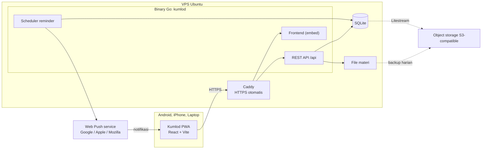
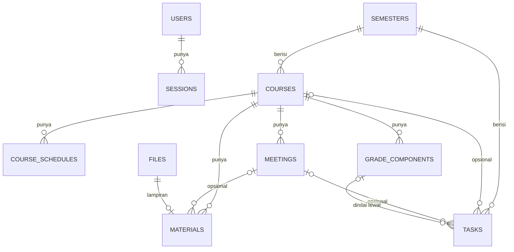

# Design: Kumlod Core

Dokumen ini menjelaskan cara Fase 1 dibangun. Kebutuhan ada di `requirements.md`, kontrak API lengkap ada di `api/openapi.yaml`.

## 1. Gambaran umum

Kumlod adalah satu binary Go yang menyajikan REST API, menjalankan scheduler reminder, dan menyajikan frontend React (PWA) yang di-embed ke dalam binary. Data disimpan di SQLite, file materi di disk. Di VPS, Caddy berdiri di depan untuk HTTPS otomatis, dan Litestream mereplikasi database ke object storage.



## 2. Keputusan teknis

| Area | Pilihan | Alasan |
|---|---|---|
| Frontend | React 19 + TypeScript + Vite (SPA) | Ekosistem komponen paling lengkap, build statis gampang di-embed dan dibungkus Capacitor nanti |
| Routing dan data | TanStack Router (file-based) + TanStack Query | Routing type-safe, cache, optimistic update, mutasi tertahan saat offline |
| UI | Tailwind CSS v4 + shadcn/ui + lucide-react | Komponen aksesibel (Radix), mobile-first |
| PWA | vite-plugin-pwa (`injectManifest`) | Service worker custom untuk push dan precache |
| Backend | Go, `net/http` bawaan | Satu binary, RAM kecil, routing method + path sudah bawaan |
| Kontrak API | OpenAPI 3.0 (`api/openapi.yaml`) | Go: `oapi-codegen` (models + std-http-server). TS: `openapi-typescript` + `openapi-fetch` |
| Database | SQLite via `modernc.org/sqlite` (tanpa CGO) | Embedded, hemat RAM, backup satu file, FTS5 bawaan |
| Akses data | SQL manual di paket `store` | Tabel sedikit, semua query dites. sqlc tidak dipakai supaya tidak ada tool generator tambahan di Windows |
| Migrasi | goose v3 dengan file SQL yang di-embed | Jalan otomatis saat start |
| ID | UUIDv7 (string) | Bisa dibuat di klien, urut waktu, portabel ke Postgres |
| Auth | Password argon2id + sesi di database + cookie HttpOnly | Sederhana dan aman untuk satu pengguna. Passkey menyusul |
| Push | Web Push + VAPID (`github.com/SherClockHolmes/webpush-go`) | Satu jalur untuk Android, iOS 16.4+, dan desktop |
| Deploy | Binary + systemd + Caddy, Litestream, rclone opsional | Tanpa Docker, cocok untuk VPS 2C2G |

Arsitektur ini single-tenant: tabel domain tidak punya `user_id`. Kalau suatu saat jadi multi-user, perlu migrasi menambah kolom pemilik.

## 3. Struktur repo

```
kumlod/
├── api/
│   ├── openapi.yaml            # kontrak API, sumber kebenaran
│   └── oapi-codegen.yaml       # config generator Go
├── cmd/kumlod/main.go          # entrypoint dan CLI
├── internal/
│   ├── api/                    # hasil generate oapi-codegen (jangan diedit manual)
│   ├── app/                    # wiring: config, db, store, service, server, scheduler
│   ├── auth/                   # argon2id, token sesi, rate limiter login
│   ├── clock/                  # abstraksi waktu untuk testing
│   ├── config/                 # baca env dan file .env
│   ├── db/                     # buka SQLite, pragma, migrasi
│   │   └── migrations/         # 00001_init.sql, ...
│   ├── domain/                 # logika murni: absensi, nilai, IPK, generate pertemuan, reminder
│   ├── files/                  # simpan, buka, hapus file materi di disk
│   ├── httpapi/                # implementasi ServerInterface, middleware, error JSON
│   ├── push/                   # VAPID dan pengiriman Web Push
│   ├── scheduler/              # loop reminder
│   ├── store/                  # satu-satunya paket yang menulis SQL
│   └── webui/                  # embed hasil build frontend, SPA fallback
│       └── dist/               # output Vite (di-ignore, kecuali .gitkeep)
├── web/                        # frontend React + Vite
├── deploy/                     # setup VPS, systemd, Caddy, Litestream, backup
├── scripts/                    # build.ps1, deploy.ps1, gen.ps1
└── docs/                       # PRD, panduan development, deploy, dan pemakaian
```

Aturan dependensi: `httpapi` memanggil `store` dan `domain`. `domain` tidak mengimpor paket internal lain selain tipe dasarnya sendiri. Hanya `store` yang berisi SQL.

## 4. Model data



### Format nilai

- ID: UUID string, dibuat server dengan UUIDv7 kalau klien tidak mengirim `id`.
- Timestamp: TEXT UTC dengan format tetap `2006-01-02T15:04:05.000Z` supaya urutan teks sama dengan urutan waktu. Di API memakai RFC 3339.
- Tanggal lokal: TEXT `YYYY-MM-DD`. Jam lokal: TEXT `HH:MM` (24 jam). Keduanya dalam zona waktu aplikasi.
- Boolean: INTEGER 0/1.
- Semua tabel biasa memakai `STRICT`.

### Skema (migrasi `00001_init.sql`)

```sql
CREATE TABLE users (
    id            TEXT PRIMARY KEY,
    username      TEXT NOT NULL UNIQUE COLLATE NOCASE,
    password_hash TEXT NOT NULL,
    created_at    TEXT NOT NULL,
    updated_at    TEXT NOT NULL
) STRICT;

CREATE TABLE sessions (
    id           TEXT PRIMARY KEY,              -- hex SHA-256 dari token cookie
    user_id      TEXT NOT NULL REFERENCES users(id) ON DELETE CASCADE,
    user_agent   TEXT NOT NULL DEFAULT '',
    created_at   TEXT NOT NULL,
    last_seen_at TEXT NOT NULL,
    expires_at   TEXT NOT NULL
) STRICT;
CREATE INDEX sessions_user ON sessions(user_id);

CREATE TABLE settings (
    key   TEXT PRIMARY KEY,                     -- 'app', 'vapid'
    value TEXT NOT NULL                         -- JSON
) STRICT;

CREATE TABLE semesters (
    id            TEXT PRIMARY KEY,
    name          TEXT NOT NULL,
    academic_year TEXT NOT NULL DEFAULT '',
    term          TEXT NOT NULL CHECK (term IN ('odd', 'even', 'short')),
    start_date    TEXT NOT NULL,
    end_date      TEXT NOT NULL,
    is_active     INTEGER NOT NULL DEFAULT 0 CHECK (is_active IN (0, 1)),
    created_at    TEXT NOT NULL,
    updated_at    TEXT NOT NULL
) STRICT;
CREATE UNIQUE INDEX semesters_single_active ON semesters(is_active) WHERE is_active = 1;

CREATE TABLE courses (
    id                 TEXT PRIMARY KEY,
    semester_id        TEXT NOT NULL REFERENCES semesters(id) ON DELETE CASCADE,
    code               TEXT NOT NULL DEFAULT '',
    name               TEXT NOT NULL,
    credits            INTEGER NOT NULL CHECK (credits BETWEEN 0 AND 24),
    lecturer           TEXT NOT NULL DEFAULT '',
    color              TEXT NOT NULL DEFAULT '#6366f1',
    total_meetings     INTEGER NOT NULL CHECK (total_meetings BETWEEN 1 AND 40),
    min_attendance_pct INTEGER NOT NULL CHECK (min_attendance_pct BETWEEN 0 AND 100),
    final_grade_letter TEXT,
    notes              TEXT NOT NULL DEFAULT '',
    created_at         TEXT NOT NULL,
    updated_at         TEXT NOT NULL
) STRICT;
CREATE INDEX courses_semester ON courses(semester_id);

CREATE TABLE course_schedules (
    id          TEXT PRIMARY KEY,
    course_id   TEXT NOT NULL REFERENCES courses(id) ON DELETE CASCADE,
    day_of_week INTEGER NOT NULL CHECK (day_of_week BETWEEN 1 AND 7),   -- ISO: 1 = Senin
    start_time  TEXT NOT NULL,
    end_time    TEXT NOT NULL,
    room        TEXT NOT NULL DEFAULT ''
) STRICT;
CREATE INDEX course_schedules_course ON course_schedules(course_id);

CREATE TABLE meetings (
    id            TEXT PRIMARY KEY,
    course_id     TEXT NOT NULL REFERENCES courses(id) ON DELETE CASCADE,
    number        INTEGER NOT NULL,
    date          TEXT NOT NULL,
    start_time    TEXT NOT NULL DEFAULT '',
    end_time      TEXT NOT NULL DEFAULT '',
    room          TEXT NOT NULL DEFAULT '',
    kind          TEXT NOT NULL DEFAULT 'lecture' CHECK (kind IN ('lecture', 'midterm', 'final')),
    status        TEXT NOT NULL DEFAULT 'scheduled' CHECK (status IN ('scheduled', 'cancelled')),
    attendance    TEXT CHECK (attendance IN ('present', 'excused', 'sick', 'absent')),
    attendance_at TEXT,
    topic         TEXT NOT NULL DEFAULT '',
    notes         TEXT NOT NULL DEFAULT '',
    created_at    TEXT NOT NULL,
    updated_at    TEXT NOT NULL
) STRICT;
CREATE INDEX meetings_course ON meetings(course_id, date);
CREATE INDEX meetings_date ON meetings(date);

CREATE TABLE grade_components (
    id        TEXT PRIMARY KEY,
    course_id TEXT NOT NULL REFERENCES courses(id) ON DELETE CASCADE,
    name      TEXT NOT NULL,
    weight    REAL NOT NULL CHECK (weight > 0 AND weight <= 100),
    score     REAL CHECK (score >= 0 AND score <= 100),
    source    TEXT NOT NULL DEFAULT 'manual' CHECK (source IN ('manual', 'tasks')),
    position  INTEGER NOT NULL DEFAULT 0
) STRICT;
CREATE INDEX grade_components_course ON grade_components(course_id);

CREATE TABLE tasks (
    id                 TEXT PRIMARY KEY,
    semester_id        TEXT NOT NULL REFERENCES semesters(id) ON DELETE CASCADE,
    course_id          TEXT REFERENCES courses(id) ON DELETE CASCADE,
    meeting_id         TEXT REFERENCES meetings(id) ON DELETE SET NULL,
    grade_component_id TEXT REFERENCES grade_components(id) ON DELETE SET NULL,
    title              TEXT NOT NULL,
    description        TEXT NOT NULL DEFAULT '',
    deadline           TEXT NOT NULL,
    status             TEXT NOT NULL DEFAULT 'todo' CHECK (status IN ('todo', 'in_progress', 'submitted', 'graded')),
    priority           TEXT NOT NULL DEFAULT 'normal' CHECK (priority IN ('low', 'normal', 'high')),
    submission_url     TEXT NOT NULL DEFAULT '',
    score              REAL CHECK (score >= 0 AND score <= 100),
    completed_at       TEXT,
    created_at         TEXT NOT NULL,
    updated_at         TEXT NOT NULL
) STRICT;
CREATE INDEX tasks_semester_deadline ON tasks(semester_id, deadline);
CREATE INDEX tasks_course ON tasks(course_id);
CREATE INDEX tasks_component ON tasks(grade_component_id);

CREATE TABLE files (
    id            TEXT PRIMARY KEY,
    original_name TEXT NOT NULL,
    mime_type     TEXT NOT NULL,
    size_bytes    INTEGER NOT NULL,
    sha256        TEXT NOT NULL,
    created_at    TEXT NOT NULL
) STRICT;

CREATE TABLE materials (
    id          TEXT PRIMARY KEY,
    course_id   TEXT NOT NULL REFERENCES courses(id) ON DELETE CASCADE,
    meeting_id  TEXT REFERENCES meetings(id) ON DELETE SET NULL,
    kind        TEXT NOT NULL CHECK (kind IN ('link', 'note', 'file')),
    title       TEXT NOT NULL,
    description TEXT NOT NULL DEFAULT '',
    url         TEXT NOT NULL DEFAULT '',
    file_id     TEXT REFERENCES files(id),
    created_at  TEXT NOT NULL,
    updated_at  TEXT NOT NULL
) STRICT;
CREATE INDEX materials_course ON materials(course_id);
CREATE INDEX materials_meeting ON materials(meeting_id);

CREATE VIRTUAL TABLE materials_fts USING fts5(
    material_id UNINDEXED,
    title,
    description,
    file_name,
    tokenize = 'unicode61 remove_diacritics 2'
);

CREATE TABLE push_subscriptions (
    id              TEXT PRIMARY KEY,
    endpoint        TEXT NOT NULL UNIQUE,
    p256dh          TEXT NOT NULL,
    auth            TEXT NOT NULL,
    user_agent      TEXT NOT NULL DEFAULT '',
    created_at      TEXT NOT NULL,
    last_success_at TEXT
) STRICT;

CREATE TABLE notification_log (
    kind    TEXT NOT NULL,
    ref     TEXT NOT NULL,
    sent_at TEXT NOT NULL,
    PRIMARY KEY (kind, ref)
) STRICT;
```

Catatan:

- Indeks FTS diisi oleh `store` di transaksi yang sama dengan insert, update, dan delete materi (bukan trigger), supaya nama file ikut terindeks dan logikanya ada di satu tempat.
- Cascade dari semester atau matkul tidak menghapus file fisik. `store` mengumpulkan `file_id` milik materi yang akan terhapus, menghapus baris `files` dan `materials_fts` terkait di transaksi yang sama, lalu `files` menghapus file fisiknya setelah commit.
- Pragma koneksi: `foreign_keys=ON`, `journal_mode=WAL`, `busy_timeout=5000`, `synchronous=NORMAL`, transaksi `_txlock=immediate`. Pool maksimal 4 koneksi.

### Pengaturan (`settings.key = 'app'`)

```json
{
  "timezone": "Asia/Jakarta",
  "grade_scale": [
    { "letter": "A",  "min_score": 85, "points": 4.0 },
    { "letter": "A-", "min_score": 80, "points": 3.7 },
    { "letter": "B+", "min_score": 75, "points": 3.3 },
    { "letter": "B",  "min_score": 70, "points": 3.0 },
    { "letter": "B-", "min_score": 65, "points": 2.7 },
    { "letter": "C+", "min_score": 60, "points": 2.3 },
    { "letter": "C",  "min_score": 55, "points": 2.0 },
    { "letter": "D",  "min_score": 40, "points": 1.0 },
    { "letter": "E",  "min_score": 0,  "points": 0.0 }
  ],
  "grade_scale_confirmed": false,
  "count_excused_as_absent": true,
  "default_min_attendance_pct": 75,
  "default_total_meetings": 16,
  "reminders": {
    "task_enabled": true,
    "attendance_enabled": true,
    "digest_enabled": true,
    "digest_time": "06:00"
  },
  "baseline": { "gpa": null, "credits": 0 }
}
```

Preset kedua (huruf ganda) hanya ada di frontend: A 80 (4.0), AB 75 (3.5), B 70 (3.0), BC 65 (2.5), C 60 (2.0), D 50 (1.0), E 0 (0.0). `grade_scale_confirmed` jadi `true` setiap kali pengaturan disimpan lewat API. Kunci `vapid` menyimpan `{ "public_key": "...", "private_key": "..." }` yang dibuat otomatis saat start pertama.

## 5. Logika domain

Semua fungsi di paket `domain` murni (tanpa I/O) dan menerima waktu dari luar.

### Absensi per matkul

```
terhitung     = pertemuan dengan kind = lecture dan status = scheduled
total         = jumlah terhitung
held          = terhitung dengan date <= hari ini
recorded      = terhitung dengan attendance terisi
present       = recorded dengan attendance = present
                (+ excused dan sick kalau count_excused_as_absent = false)
absences      = recorded - present
unrecorded    = terhitung dengan date < hari ini dan attendance kosong
required      = ceil(min_pct x total / 100)      -> integer: (min_pct*total + 99) / 100
max_absences  = total - required
remaining     = max_absences - absences
percentage    = recorded > 0 ? round1(present x 100 / recorded) : null
level         = total = 0 ? safe
                : remaining > 1 ? safe : remaining = 1 ? warning
                : remaining = 0 ? critical : exceeded
```

Contoh: 14 pertemuan kuliah, batas 75% -> required 11, jatah bolos 3.

### Nilai per matkul

```
efektif(c)      = c.source = manual ? c.score : rata-rata score tugas dengan grade_component_id = c.id dan score terisi
total_weight    = jumlah bobot
known_weight    = jumlah bobot komponen dengan efektif terisi
known_points    = jumlah bobot x efektif
current_score   = known_weight > 0 ? known_points / known_weight : null
is_final        = ada komponen dan semua punya efektif
final_score     = is_final ? known_points / total_weight : null
letter          = huruf(is_final ? final_score : current_score)
remaining       = total_weight - known_weight
target(huruf h) = remaining = 0 ? (final_score >= h.min ? secured : impossible), required = null
                : req = (h.min x total_weight - known_points) / remaining
                  status = req <= 0 ? secured : req <= 100 ? possible : impossible
                  required = max(req, 0) dibulatkan ke atas 2 desimal
```

`huruf(s)` mencari entri pertama di skala (urut `min_score` menurun) dengan `round2(s) >= min_score`. Semua skor di output dibulatkan 2 desimal.

### IPS, IPK, dan simulasi

```
huruf_dipakai(c) = final_grade_letter kalau ada di skala, selain itu letter hasil hitung
points(c)        = bobot huruf_dipakai(c) di skala
IPS(semester)    = jumlah(points x credits) / graded_credits, null kalau graded_credits = 0
is_projected     = ada matkul yang memakai huruf hasil hitung
IPK              = (baseline_points + jumlah semua points x credits) / (baseline_credits + jumlah graded_credits)
                   baseline dipakai hanya kalau baseline.gpa terisi dan baseline.credits > 0
simulasi(target) = C_cur = total SKS semua matkul di semester aktif (bergraded atau tidak)
                   C_cur = 0 atau tanpa semester aktif -> no_credits
                   P_prev, C_prev = baseline + semester lain yang graded
                   req = (target x (C_prev + C_cur) - P_prev) / C_cur
                   req <= 0 -> secured (required_ips = 0), req <= 4 -> possible, selain itu impossible
```

### Generate pertemuan

Mulai dari `semester.start_date`, iterasi tanggal per hari. Di tiap tanggal, ambil slot yang `day_of_week` sama dengan hari ISO tanggal itu, urut `start_time`. Setiap pasangan (tanggal, slot) jadi satu pertemuan sampai jumlahnya `total_meetings`, dengan batas pengaman 400 hari. Nomor 1..N. Kalau N >= 4, pertemuan ke `N/2` (pembagian bulat) jadi `midterm` dan ke `N` jadi `final`. Jam dan ruang disalin dari slot.

### Jendela reminder tugas

```
sisa = deadline - now
sisa <= 0           -> tidak ada
sisa <= 3 jam       -> task_3h
sisa <= 24 jam      -> task_24h
sisa <= 72 jam      -> task_72h
selain itu          -> tidak ada
```

Hanya jendela hasil fungsi ini yang dikirim, jadi tugas yang dibuat 2 jam sebelum deadline cuma dapat `task_3h`. Ref log: `<task_id>|<deadline>`, sehingga mengubah deadline mereset reminder.

## 6. API

Kontrak lengkap ada di `api/openapi.yaml`. Konvensi:

- Prefix `/api`, JSON snake_case, `Content-Type: application/json`.
- Update memakai PUT dengan objek lengkap. Field nullable dikirim `null` untuk mengosongkan.
- `POST`, `PUT`, `DELETE` wajib header `X-Requested-With: kumlod`.
- Create menerima `id` opsional (UUID). Kalau `id` sudah dipakai, balas 409.
- Error selalu `{"error": {"code": "...", "message": "...", "fields": {...}}}` dengan pesan berbahasa Indonesia.

| Status | Code | Kapan |
|---|---|---|
| 400 | `validation_error` | Input tidak valid, `fields` berisi pesan per field |
| 401 | `unauthenticated` | Tanpa sesi atau login gagal |
| 403 | `csrf_failed` | Header `X-Requested-With` hilang |
| 404 | `not_found` | Data tidak ada |
| 409 | `conflict` | ID bentrok, generate pertemuan saat sudah ada |
| 413 | `file_too_large` | Upload melebihi batas |
| 429 | `rate_limited` | Terlalu banyak percobaan login |
| 500 | `internal` | Error tak terduga (detail hanya di log) |

Ringkasan endpoint:

| Area | Endpoint |
|---|---|
| Sistem | `GET /api/health` |
| Auth | `POST /api/auth/login`, `POST /api/auth/logout`, `GET /api/auth/me`, `PUT /api/auth/password` |
| Pengaturan | `GET`, `PUT /api/settings` |
| Dashboard | `GET /api/dashboard` |
| Semester | `GET`, `POST /api/semesters`, `GET`, `PUT`, `DELETE /api/semesters/{id}`, `POST /api/semesters/{id}/activate` |
| Matkul | `GET`, `POST /api/semesters/{id}/courses`, `GET`, `PUT`, `DELETE /api/courses/{id}` |
| Pertemuan | `GET`, `POST /api/courses/{id}/meetings`, `POST /api/courses/{id}/meetings/generate`, `PUT`, `DELETE /api/meetings/{id}`, `PUT /api/meetings/{id}/attendance` |
| Nilai | `GET /api/courses/{id}/grades`, `PUT /api/courses/{id}/grades/components`, `GET /api/gpa?target_ipk=` |
| Tugas | `GET`, `POST /api/tasks`, `GET`, `PUT`, `DELETE /api/tasks/{id}`, `PUT /api/tasks/{id}/status` |
| Materi | `GET`, `POST /api/materials`, `POST /api/materials/upload`, `GET`, `PUT`, `DELETE /api/materials/{id}`, `GET /api/files/{id}` |
| Push | `GET /api/push/public-key`, `POST /api/push/subscriptions`, `POST /api/push/unsubscribe`, `POST /api/push/test` |

Filter `semester_id` pada daftar tugas dan materi default ke semester aktif. Nilai `all` berarti semua semester. Kalau tidak ada semester aktif dan filter kosong, hasilnya daftar kosong.

Tugas baru dengan matkul tapi tanpa `grade_component_id` otomatis terhubung ke komponen bersumber tugas di matkul itu kalau jumlahnya tepat satu, supaya template default (Tugas 30%) langsung terisi dari nilai tugas. Daftar `upcoming_tasks` di dashboard mencakup deadline sampai akhir hari ke-7 setelah hari ini (zona waktu aplikasi), sama dengan kelompok "7 hari ke depan" di halaman Tugas.

## 7. Autentikasi dan keamanan

- Akun dibuat lewat `kumlod user create <username>`. Password minimal 8 karakter, di-hash argon2id (memory 64 MiB, iterations 3, parallelism 2, salt 16 byte, key 32 byte) dengan format PHC `$argon2id$v=19$m=65536,t=3,p=2$<salt>$<hash>`.
- Login membuat token acak 32 byte (base64url) untuk cookie `kumlod_session`. Database menyimpan hex SHA-256 token. Cookie: `HttpOnly`, `SameSite=Lax`, `Path=/`, `Secure` kalau `KUMLOD_COOKIE_SECURE=true`, `Max-Age` 30 hari.
- Middleware sesi memperbarui `last_seen_at` paling sering sekali per 5 menit dan memperpanjang `expires_at` ke 30 hari ke depan kalau sisa masa berlakunya di bawah 15 hari.
- Rate limit login: 5 kegagalan per IP per 15 menit, disimpan di memori. Tiap percobaan dicatat sebelum password diperiksa dan catatan dihapus saat login berhasil, jadi request paralel tidak bisa melewati batas. IP diambil dari entri terakhir `X-Forwarded-For` (yang ditambahkan Caddy) hanya kalau `KUMLOD_TRUST_PROXY=true`.
- argon2id butuh 64 MiB per hash, jadi hashing dijalankan satu per satu dan memori dikembalikan ke OS setelahnya. Binary memasang batas heap lunak 100 MB (`GOMEMLIMIT` menimpa).
- Proteksi CSRF: SameSite=Lax ditambah header wajib `X-Requested-With: kumlod` di semua request yang mengubah data. Server tidak mengaktifkan CORS.
- Batas body JSON 1 MB, batas upload `KUMLOD_MAX_UPLOAD_MB` (default 50).
- Header untuk semua respons: `X-Content-Type-Options: nosniff`, `X-Frame-Options: DENY`, `Referrer-Policy: same-origin`, `Permissions-Policy: camera=(), microphone=(), geolocation=()`. Respons HTML menambah CSP: `default-src 'self'; script-src 'self'; style-src 'self' 'unsafe-inline'; img-src 'self' data: blob:; font-src 'self'; connect-src 'self'; worker-src 'self'; manifest-src 'self'; frame-ancestors 'none'; base-uri 'self'; form-action 'self'`.
- Caddy menambah HSTS di produksi.

## 8. Scheduler dan notifikasi

- Satu goroutine, tick tiap 60 detik (tick pertama 10 detik setelah start), berhenti saat shutdown.
- Setiap tick membaca pengaturan, menghitung `now` di zona waktu aplikasi, lalu menjalankan tiga job: reminder tugas, pengingat absen, ringkasan harian. Kalau belum ada subscription, job dilewati tanpa mencatat log.
- Idempotensi lewat `notification_log`: `INSERT ... ON CONFLICT DO NOTHING`. Kirim hanya kalau baris baru tercatat. Kalau semua pengiriman gagal karena error jaringan, baris log dihapus supaya dicoba lagi di tick berikutnya.
- Payload push: `{"title": "...", "body": "...", "url": "/...", "tag": "..."}`. Service worker menampilkan notifikasi dan membuka `url` saat diklik.

| Job | Kondisi | Log kind dan ref | URL |
|---|---|---|---|
| Reminder tugas | status `todo` atau `in_progress`, jendela sesuai fungsi di bagian 5 | `task_72h` / `task_24h` / `task_3h`, `<task_id>\|<deadline>` | `/tugas/<id>` |
| Pengingat absen | pertemuan hari ini, `scheduled`, attendance kosong, punya jam mulai, `now >= mulai + 15 menit` dan `now <= selesai + 2 jam` | `attendance`, `<meeting_id>\|<date>` | `/?meeting=<id>` |
| Ringkasan harian | `now` di antara `digest_time` dan `digest_time + 2 jam`, ada kuliah hari ini atau tugas dengan deadline 48 jam ke depan | `digest`, `<YYYY-MM-DD>` | `/` |

- Respons 404 atau 410 dari push service menghapus subscription. Respons sukses memperbarui `last_success_at`.
- Subject VAPID dari `KUMLOD_VAPID_SUBJECT` (wajib `mailto:` atau `https:` di produksi). TTL 12 jam, urgency high.

## 9. Penyimpanan file

- Lokasi: `<data_dir>/files/<2 karakter pertama id>/<id>`. Upload ditulis dulu ke `<data_dir>/files/tmp`, SHA-256 dihitung sambil menulis, lalu di-rename setelah baris database tersimpan.
- MIME ditentukan dari `http.DetectContentType` 512 byte pertama, dengan ekstensi sebagai cadangan kalau hasilnya `application/octet-stream`.
- Download memakai `http.ServeContent` (mendukung Range). Inline hanya untuk `application/pdf`, `image/png`, `image/jpeg`, `image/gif`, `image/webp`, kecuali `?download=true`. Selain itu `Content-Disposition: attachment` dengan `filename*` UTF-8 dan `Content-Security-Policy: default-src 'none'; sandbox`.
- Nama file asli disanitasi (tanpa path, tanpa karakter kontrol, maksimal 200 karakter).

## 10. Frontend

### Rute

| Path | Isi |
|---|---|
| `/login` | Form login |
| `/` | Hari Ini: kuliah hari ini dengan tombol absen, peringatan absen, tugas terlambat dan 7 hari ke depan |
| `/tugas` | Daftar tugas dengan filter status dan matkul, dikelompokkan per waktu |
| `/tugas/$taskId` | Detail dan edit tugas |
| `/matkul` | Daftar matkul semester terpilih (default aktif) |
| `/matkul/baru` | Form matkul baru (jadwal, default dari pengaturan, opsi generate pertemuan) |
| `/matkul/$courseId` | Detail matkul dengan tab `pertemuan`, `tugas`, `materi`, `nilai` (search param `tab`) |
| `/matkul/$courseId/edit` | Edit matkul |
| `/materi` | Pencarian dan daftar materi |
| `/nilai` | IPS per semester, IPK, simulasi target IPK |
| `/semester` | Daftar, buat, edit, aktifkan, hapus semester |
| `/pengaturan` | Notifikasi perangkat, reminder, absensi, skala nilai, baseline IPK, zona waktu, akun, cara install |
| `/lainnya` | Menu tambahan di HP (Nilai, Semester, Pengaturan) |

### Tata letak dan interaksi

- Mobile-first. Di bawah 768 px ada navigasi bawah: Hari Ini, Tugas, Matkul, Materi, Lainnya. Di atasnya sidebar.
- Tombol tambah tugas cepat (FAB di HP, tombol di header desktop) membuka dialog: judul, matkul, tanggal (default hari ini), jam (default 23:59), prioritas.
- Pemilih absen berupa 4 tombol toggle (Hadir, Izin, Sakit, Alpa) dengan `aria-pressed`. Tap tombol yang aktif menghapus catatan.
- Input tanggal dan jam memakai `<input type="date">` dan `<input type="time">` bawaan supaya picker native di HP.
- Level absen ditampilkan sebagai badge berteks: Aman, Waspada, Kritis, Lewat batas.
- Bahasa Indonesia, format tanggal `date-fns` locale `id`.

### Lapisan data

- `src/api/schema.d.ts` di-generate dari `api/openapi.yaml` dengan `openapi-typescript`. Klien `openapi-fetch` memakai `credentials: 'same-origin'` dan selalu menambah header `X-Requested-With: kumlod`.
- Respons 401 menghapus cache dan mengarahkan ke `/login`.
- TanStack Query dengan key per sumber data. Mutasi absen dan status tugas memakai optimistic update. `networkMode` default membuat mutasi tertahan saat offline dan dikirim lagi saat online.
- Cache query dipersist ke IndexedDB (`@tanstack/query-async-storage-persister` + `idb-keyval`), maksimal 7 hari, dihapus saat logout.
- ID untuk data baru dibuat di klien dengan UUIDv7.

### PWA

- `vite-plugin-pwa` mode `injectManifest`, service worker `src/sw.ts`: precache aset build, navigasi fallback ke `index.html` kecuali `/api/`, handler `push` dan `notificationclick`, update dengan prompt.
- Manifest: nama Kumlod, `display: standalone`, `lang: id`, ikon 192, 512, dan maskable 512, plus `apple-touch-icon` 180.
- Halaman pengaturan mendeteksi iOS non-standalone dan menampilkan langkah Add to Home Screen. Izin notifikasi hanya diminta lewat tap tombol.
- Tanpa script inline supaya sesuai CSP.

### Aksesibilitas

Label di semua input, fokus terlihat, target sentuh minimal 44 px, status tidak hanya lewat warna, toast lewat region `aria-live`, `lang="id"` di HTML, menghormati `prefers-reduced-motion`.

## 11. Konfigurasi

| Variabel | Default | Keterangan |
|---|---|---|
| `KUMLOD_ADDR` | `127.0.0.1:8080` | Alamat listen |
| `KUMLOD_DATA_DIR` | `./data` | Berisi `kumlod.db` dan folder `files/` |
| `KUMLOD_DEV` | `false` | Mode development: log teks, cookie tanpa Secure |
| `KUMLOD_COOKIE_SECURE` | `true` (`false` kalau `KUMLOD_DEV=true`) | Atribut Secure cookie |
| `KUMLOD_TRUST_PROXY` | `false` | Pakai `X-Forwarded-For` untuk IP klien |
| `KUMLOD_VAPID_SUBJECT` | `mailto:admin@localhost` | Wajib diisi email atau URL asli di produksi |
| `KUMLOD_MAX_UPLOAD_MB` | `50` | Batas upload |
| `KUMLOD_LOG_FORMAT` | `json` (`text` kalau dev) | Format log |

File `.env` di working directory dibaca saat start tanpa menimpa variabel yang sudah ada.

CLI binary:

```
kumlod serve                               # default kalau tanpa argumen
kumlod migrate
kumlod user create <username> [--password-stdin]
kumlod user passwd <username> [--password-stdin]
kumlod version
```

## 12. Penanganan error

- Handler mengembalikan error domain bertipe (`ValidationError` dengan map field, `ErrNotFound`, `ErrConflict`), lalu satu fungsi memetakannya ke status dan JSON.
- Panic ditangkap middleware recover, dicatat di log, dibalas 500 tanpa detail.
- Frontend menampilkan `error.message` lewat toast dan pesan per field di form.

## 13. Strategi testing

| Lapisan | Cara |
|---|---|
| `domain` | Table-driven test: absensi (termasuk aturan izin/sakit dan level), nilai dan target, IPS/IPK dan simulasi, generate pertemuan, jendela reminder |
| `store` | SQLite sementara dengan migrasi: satu semester aktif, cascade, FTS, file ikut terhapus |
| `httpapi` | `httptest`: login, rate limit, CSRF, 401, validasi, upload dan header download |
| `scheduler` | Jam palsu dan sender palsu: tiap jendela terkirim sekali, ringkasan sekali per hari |
| Frontend | Vitest untuk helper (pengelompokan tugas, format tanggal, label absen), typecheck, build |
| End-to-end | Smoke test manual lewat API dan browser setelah build |

## 14. Deploy dan operasional

| Item | Lokasi |
|---|---|
| Binary | `/opt/kumlod/kumlod` |
| Data | `/var/lib/kumlod/data/kumlod.db`, `/var/lib/kumlod/data/files/` |
| Env | `/etc/kumlod/kumlod.env` (root:kumlod, 640) |
| Service | `kumlod.service` (user `kumlod`, hardening systemd) |
| Proxy | Caddy, `reverse_proxy 127.0.0.1:8080`, HSTS, kompresi |
| Backup DB | Litestream ke object storage S3-compatible |
| Backup file | Timer systemd harian dengan rclone (opsional) |
| Helper | `/usr/local/bin/kumlodctl` menjalankan CLI sebagai user `kumlod` dengan env produksi |

Build dari Windows: `scripts/build.ps1` membangun frontend lalu cross-compile `GOOS=linux GOARCH=amd64 CGO_ENABLED=0`. `scripts/deploy.ps1` mengunggah binary lewat `scp`, memasangnya, me-restart service, lalu cek `/api/health`.

## 15. Pengembangan lanjutan

- Moodle: job baru di scheduler yang membaca iCal export dan menulis tugas dengan kolom sumber eksternal.
- Share dari WhatsApp: `share_target` di manifest dan handler POST di service worker (Android).
- Pindah ke Postgres: ganti dialek migrasi dan query di `store`, pindahkan data dengan pgloader, ganti FTS5 ke `tsvector`. Paket lain tidak berubah.
