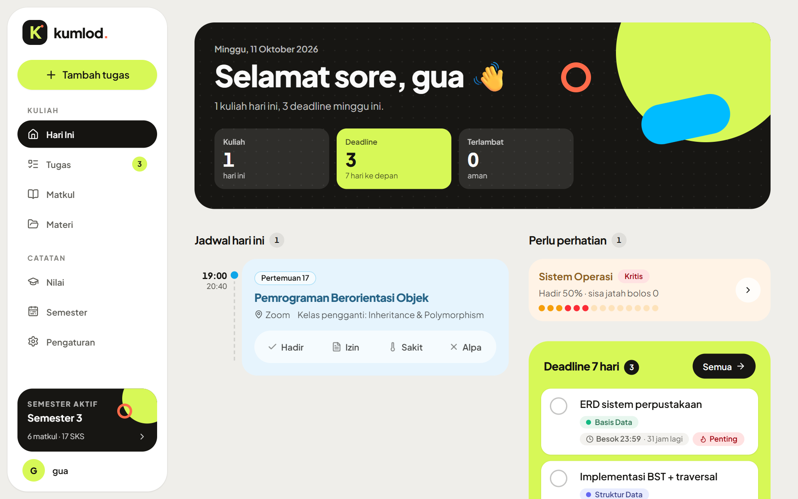
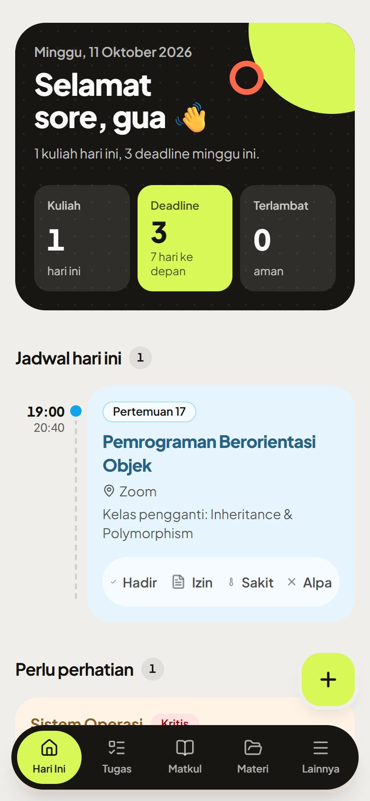
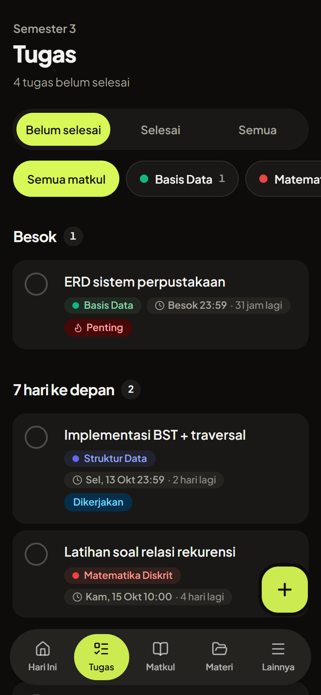
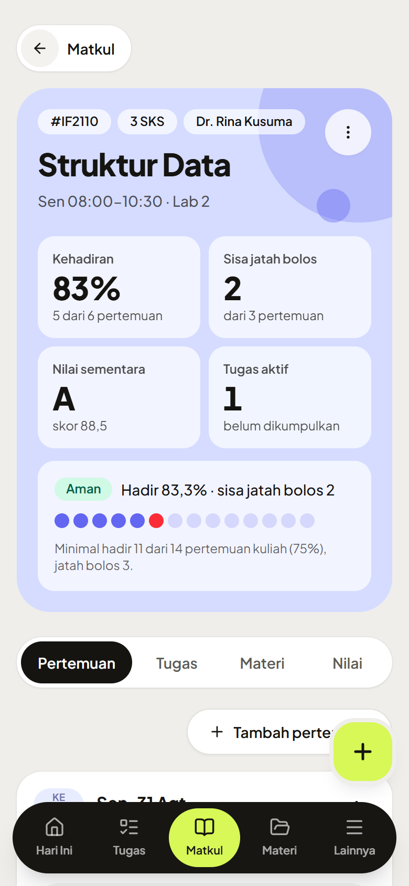
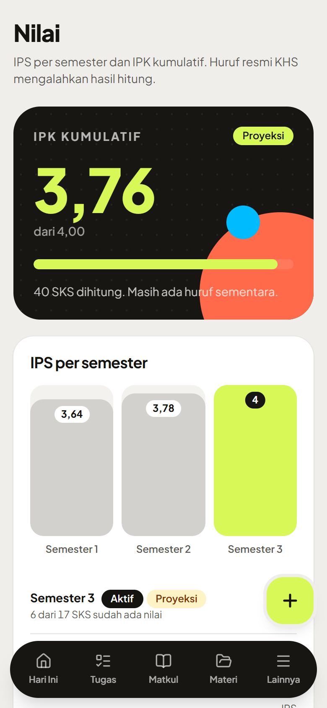

# kumlod

app kuliah buat gua sendiri. jadwal, absen, tugas, materi, nilai. ya segitu.

usernya satu, jadi ga ada tombol daftar. dibuka di hp atau laptop, servernya numpang di vps.

<p align="center">
  
</p>

<p align="center">
  
  
  
  
</p>

absen tinggal tap. tugas dikasih notif sebelum deadline, kalau udah dicentang diem. materi dikumpulin biar ga scroll wa jam 1 pagi. nilai sementara keliatan, plus kira-kira uas butuh berapa. pagi-pagi ada notif ringkasan, dibaca atau di-skip terserah.

## laptop

go 1.27+, node 24+.

```powershell
Copy-Item .env.example .env
go run ./cmd/kumlod user create gua
go run ./cmd/kumlod serve
```

terminal sebelah:

```powershell
cd web
npm ci
npm run dev
```

`http://localhost:5173`

openapi diubah-ubah: `./scripts/gen.ps1`. ngetes: `go test ./...` sama `npm test` di `web`.

## vps

```powershell
./scripts/build.ps1 -Test
./scripts/deploy.ps1 -Server root@IP -Setup -Domain kumlod.example.com -Email kamu@example.com
ssh -t root@IP kumlodctl user create gua
```

binary, systemd, caddy, litestream. yang panjang ada di [docs/DEPLOYMENT.md](docs/DEPLOYMENT.md).

notif iphone cuma hidup kalau app-nya dari home screen. emang gitu. cara pake sisanya di [docs/USER_GUIDE.md](docs/USER_GUIDE.md).

kumlod dari cumlaude. secara teori.
